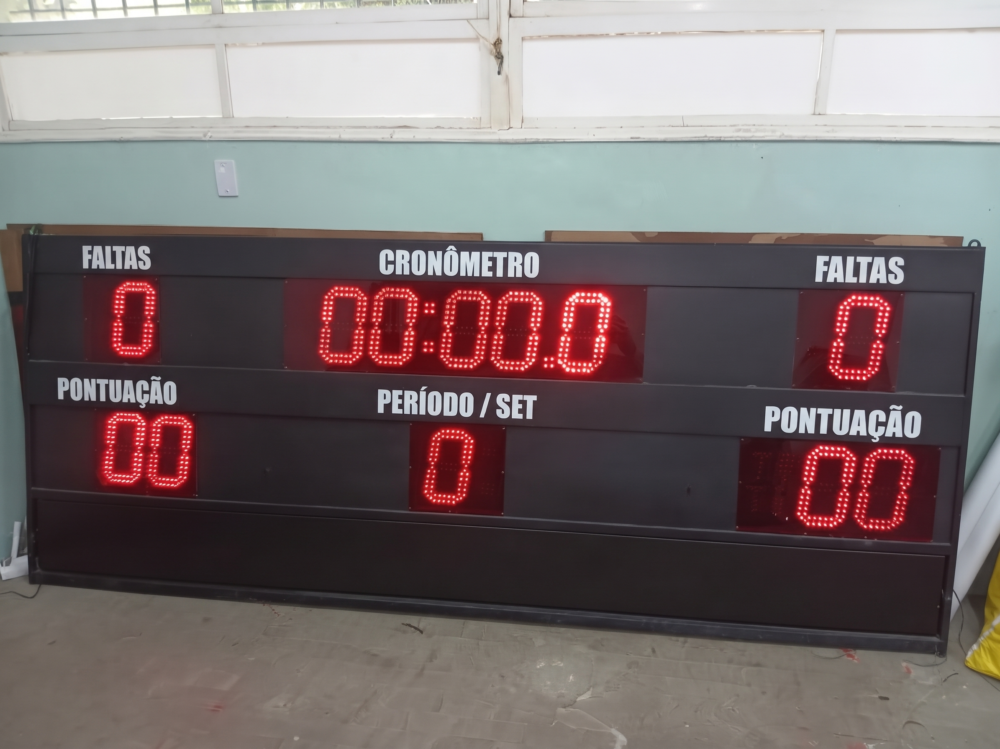
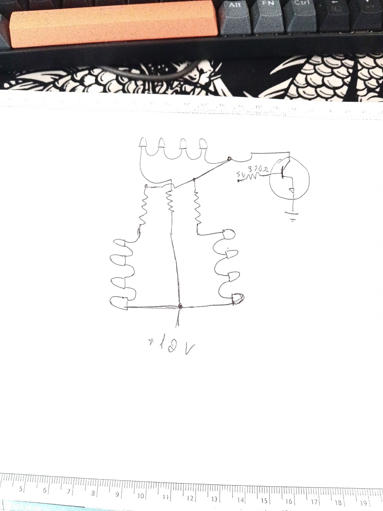

# Sistema de Placar Eletrônico Poliesportivo via Wi-Fi 🏀🏐⚽

🔗 **Acesse a simulação interativa da interface Web aqui:** [https://andreykaua90-blip.github.io/placar-eletronico-poliesportivo/](https://andreykaua90-blip.github.io/placar-eletronico-poliesportivo/)

Um projeto de hardware e software para um placar eletrônico poliesportivo de grande porte, controlado remotamente por meio de uma interface Web responsiva via Wi-Fi.

## 📖 Visão Geral do Sistema

O sistema apresenta módulos independentes para visualização de:
*   **Faltas** (Local e Visitante, 0 a 19).
*   **Cronômetro Principal** (5 dígitos: 00:00.0).
*   **Pontuação** (Local e Visitante, 0 a 199).
*   **Período / Set** (0 a 9).
*   **Tempo Técnico** (T1 a T4) e **Sirene** automática.

O placar opera sob uma **arquitetura de processamento distribuído**. Um **ESP32** atua como controlador Mestre (Web Server HTTP), roteando comandos de texto via protocolo Serial (UART a 9600 bps) para **5 Arduinos Escravos** (1 Mega e 4 Unos), que controlam fisicamente a eletrônica de potência dos displays.

## 🧠 Arquitetura de Comunicação (Mestre-Escravo)

O tráfego de dados é dividido pelo ESP32 em três barramentos UART independentes para otimizar o processamento:

1.  **Serial 0 (TX0):** Ligação direta com o Arduino Mega 2560 (Cronômetro e Sirene).
2.  **Serial 1 (Pinos 22/23):** Topologia Daisy Chain para o lado LOCAL (Controlador de Faltas -> Display de Pontuação).
3.  **Serial 2 (Pinos 19/21):** Topologia Daisy Chain para o lado VISITANTE (Controlador de Faltas/Set -> Display de Pontuação).

## 🔌 Eletrônica de Potência e Chaveamento

Cada dígito do placar utiliza uma placa de 7 segmentos da marca Microzon (DIGITO 24 CM). 
*   **Segmentos de LED:** Cada segmento possui 12 LEDs de alto brilho, arranjados em 3 séries paralelas de 4 LEDs, utilizando um resistor limitador de 180 Ω por série.
*   **Alimentação:** A alimentação opera em +12V (Ânodo Comum) com barramento central interligado.
*   **Chaveamento (Low-Side):** O acionamento é feito chaveando o GND via transistores NPN (BC250 adaptado em emissor comum) acionados pelos sinais lógicos de 5V dos Arduinos através de resistores de 330 Ω na base. 

*(Diagrama do chaveamento de GND - Low-Side)*

## 💻 Estrutura do Firmware (`/firmware`)

O projeto exige a gravação de 6 códigos distintos, um para cada placa microcontroladora:

1.  **`Master_ESP32_Server.ino`**: Roda no ESP32. Hospeda a página Web e envia os comandos seriais.
2.  **`Modulo_Cronometro_Principal.ino`**: Roda no Arduino Mega. Calcula décimos de segundo matematicamente, aciona os 35 pinos de segmentos e a sirene de 12V.
3.  **`Node_Local_Controlador.ino`**: Roda no Arduino Uno (Nó 1 Local). Gerencia faltas (0-19) e repassa os pontos adiante.
4.  **`Node_Local_Display.ino`**: Roda no Arduino Uno (Nó 2 Local). Processa dezenas e centenas da pontuação local (0-199).
5.  **`Node_Visitante_Controlador.ino`**: Roda no Arduino Uno (Nó 1 Visitante). Gerencia faltas visitantes e o mostrador de Período/Set.
6.  **`Node_Visitante_Display.ino`**: Roda no Arduino Uno (Nó 2 Visitante). Processa a pontuação visitante.

## ⚙️ Procedimento de Operação

1. Conecte-se à rede Wi-Fi configurada no firmware.
2. Acesse o endereço IP estático do painel via navegador: `http://192.168.1.200`.
3. Na interface Web, o botão "Inverter" permite alternar a funcionalidade dos botões entre adição (Inverter +) e subtração (Inverter -) de valores.
4. Para o cronômetro, digite os minutos, clique em "Confirmar" e, em seguida, em "Crescente" ou "Decrescente" para iniciar.

## 🛠️ Dicas de Manutenção (Troubleshooting)
*   **Segmento de LED não acende:** Verifique se há saída de 5V do pino do Arduino e ≈0,7V na base do transistor. Se houver, mas não acender, o transistor pode estar aberto ou com falha de solda no GND.
*   **Faltas mudam, mas a pontuação não:** Inspecione a ligação entre o TX (Pino 1) da placa Controladora e o RX (Pino 0) da placa Display.
*   **Falha geral de comunicação:** Garanta que todos os microcontroladores (ESP32, Mega, Unos) e a fonte de 12V compartilhem o **mesmo barramento de Terra (GND)** para o correto retorno pelo emissor dos transistores.
